# WHOJ Quick Links

A single-page website for residents of Weed, Hoobler, Ott, and Johnson Living Centers (WHOJ) at Grand Valley State University. It collects the answers residents ask their RAs for most, such as who to call, lockouts, work orders, laundry, Wi-Fi, and campus resources, in one place.

Live site: https://gv-whoj.github.io

This document explains what the site and its admin page can do, with screenshots. All screenshots use sample events and dates.

## At a glance

| Item | Detail |
|---|---|
| Audience | WHOJ residents (public page) and WHOJ RAs (admin page) |
| Hosting | GitHub Pages, free, no server or database |
| Resident data collected | None. There are no forms, accounts, or cookies. |
| Usage counts | Anonymous visit and link-click totals through GoatCounter. No cookies and no personal data. |
| Who can publish | Only people with a GitHub token for this repository |

## What residents see

### Who to call, with live status

The top of the page lists the numbers residents need most: the WHOJ RA Duty Phone, 911, GVPD non-emergency, North Campus Desk, Facilities, and the Central Housing Office. The page checks Michigan time and marks the duty phone as monitored or not, and the North Campus Desk as open or closed, so a resident sees the right number for the moment they are looking. Every number has a Copy button, and on phones a Call button that dials it directly.

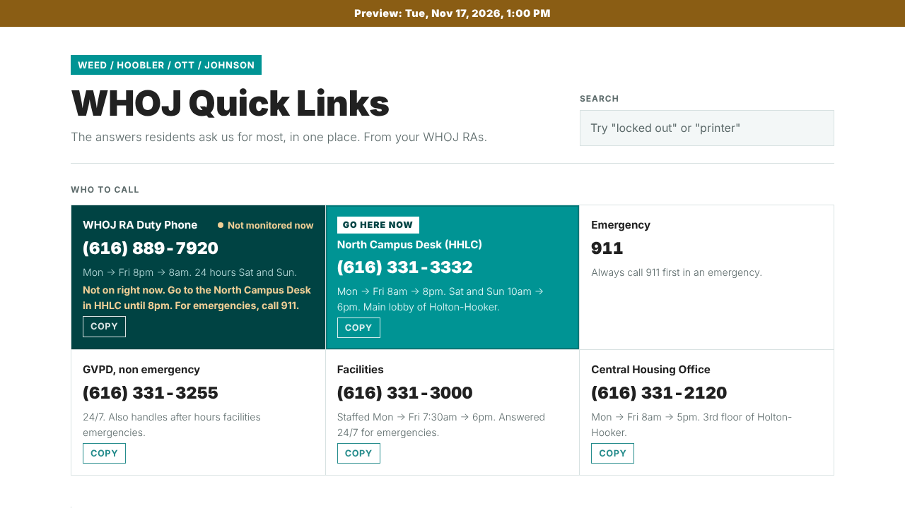

After the desk closes, the duty phone is highlighted.

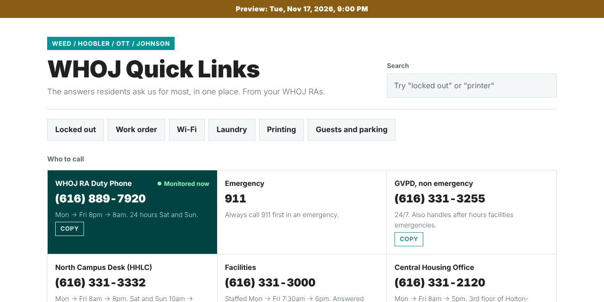

### Common needs

A row of buttons under the title jumps straight to the most asked-about answers: locked out, work orders, Wi-Fi, laundry, printing, and guests and parking.

### Search

A search box filters the full page as the resident types. Searching "printer", for example, shows only the printing answers.

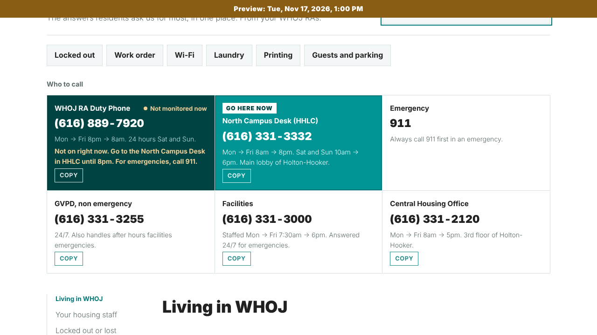

### 13 sections of answers

Locked out or lost something, mail and packages, work orders and repairs, laundry, Wi-Fi and devices, guests and parking, dining, printing, getting around, campus life, living together, support and campus resources, and a section introducing the housing staff (CD and RAs). The sections are grouped under "Living in WHOJ" and "Thriving in and around campus", and a side index lets residents jump between them.

### Event banner

On the day an RA event happens, a banner at the top shows the title, a short description, the location, and the time. Several events on the same day stack, earliest first. An event with an end time shows "Happening now" while it is on and disappears when it ends. An event with no end time stays up all day.

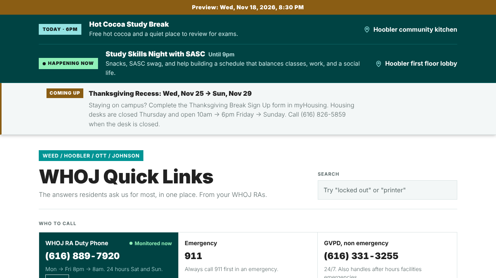

### Break banner

Starting seven days before a university break, a banner shows the break dates and a short message. During a break the page can also show that the desk is closed, show special desk hours, and swap in a different duty phone number.

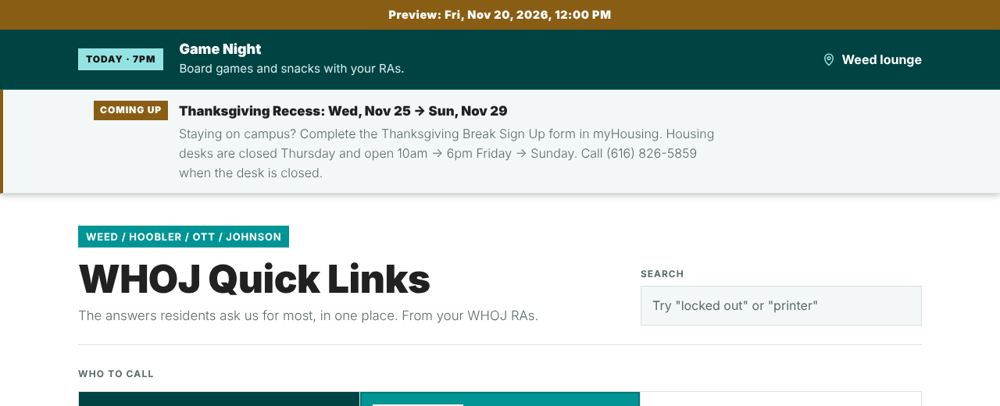

### Banners stay visible

Event and break banners stay pinned to the top while the resident scrolls. On phones the pinned area shows one line until the resident taps Show details. If many banners are active, the pinned area is limited to under half the screen and scrolls within itself.

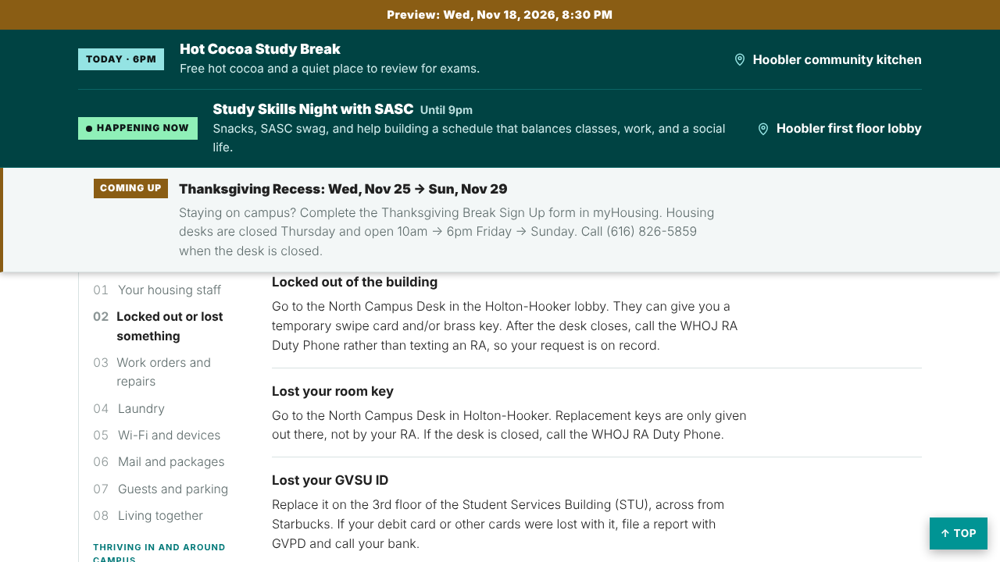

### Sharing one answer

Every answer has a small link icon next to its title. RAs can paste the link into GroupMe and the resident lands on that exact answer, highlighted.

### Phone friendly

Most residents will open the page on a phone, so the layout is built for narrow screens.

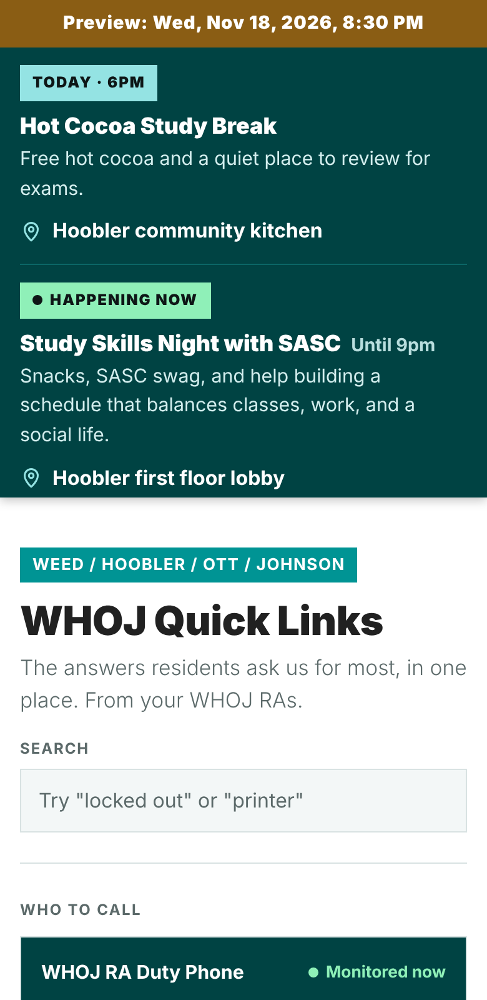

### Sign in

The admin page asks for a password. The real control over what gets published is the GitHub token described under "Connecting publishing" below.

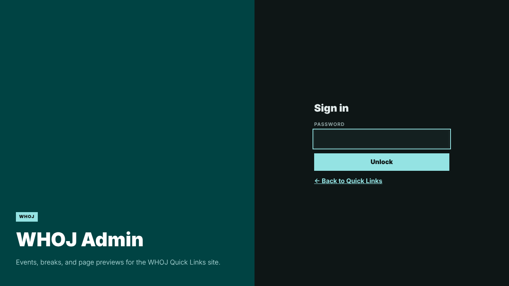

### Events

Events are listed under Today, Coming up, and Past. Each can be edited or deleted. The editor takes a title, a short description (160 characters), a date, a start time, an optional end time, and a location, and shows a live sample of the banner as it will appear.

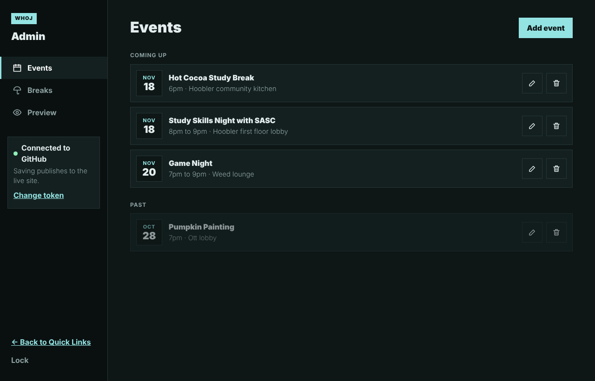

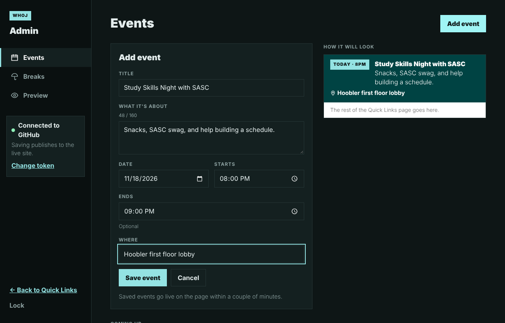

### Breaks

Name, first and last day, banner message, whether the desk is open as usual, closed for the whole break, or closed on certain days, optional special desk hours, and an optional different duty phone number with an end date.

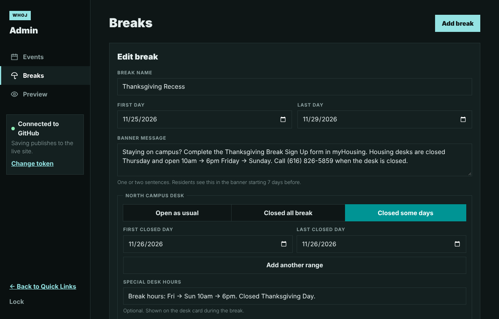

### Preview

Preview shows the resident page as it would look at any Michigan date and time, on a phone or a desktop screen. One-click shortcuts jump to useful moments, such as the duty phone starting at 8pm, a break starting, or an event happening now. Nothing in Preview changes the live site, and visits made through Preview are not counted in usage totals.

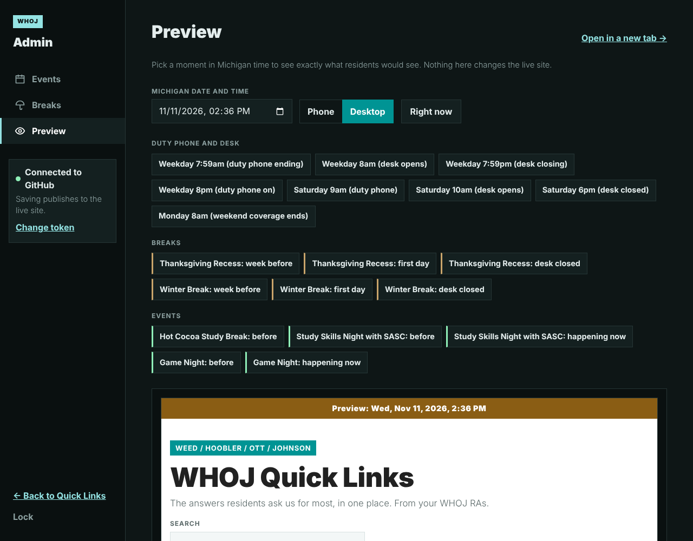

### Connecting publishing

Saving an event or break updates the live site. To allow this, the admin page is connected once per browser with a GitHub fine-grained token limited to this single repository (Contents: Read and write). The token is stored only in that browser, and the Lock button removes it. Saved changes appear on the live site within a couple of minutes.

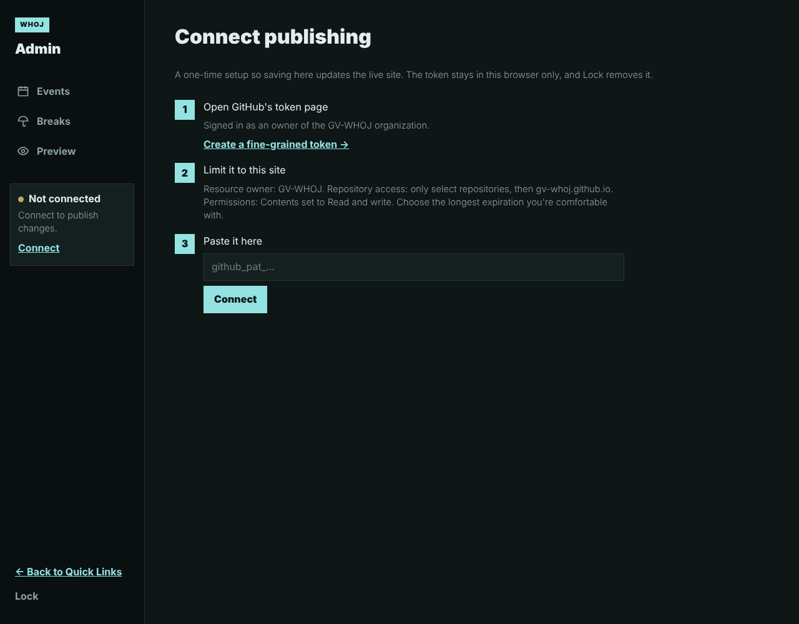

## Maintainer

Joshua Eapen, Hoobler Living Center Resident Assistant.
